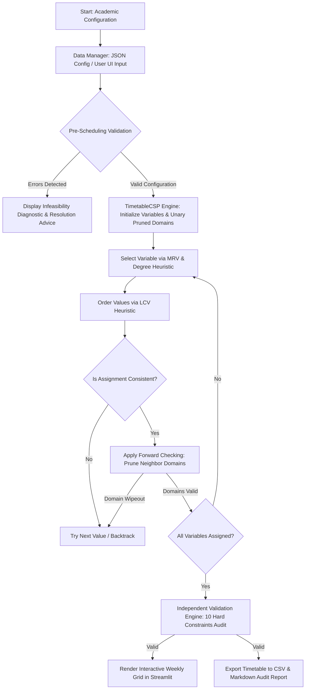

# SmartSlot AI: Intelligent Academic Timetable Generator
## Project Report & Academic Deliverable
**Course:** Artificial Intelligence / Advanced Intelligent Systems (AISC)  
**Institution (Demonstration):** Northstar Institute of Technology (Fictional)  
**Core AI Concepts:** Constraint Satisfaction Problems (CSP), Backtracking Search, MRV Heuristic, LCV Heuristic, Forward Checking  

---

## 1. Abstract
Academic timetable scheduling is an NP-complete combinatorial problem faced by universities worldwide. The challenge lies in assigning classes, faculty members, and student cohorts to classrooms and time slots while satisfying a diverse web of physical and operational constraints. Traditional manual approaches are prone to human error, double-booking, and days of administrative churn.

**SmartSlot AI** addresses this challenge by formulating academic timetabling as a formal **Constraint Satisfaction Problem (CSP)** and implementing an intelligent **Backtracking Search** engine in Python. The system integrates domain-filtering unary pruning, **Minimum Remaining Values (MRV)** with Degree Heuristic tie-breaking for variable selection, **Least Constraining Value (LCV)** for candidate ordering, and **Forward Checking (FC)** for early dead-end detection. An independent verification engine audits generated schedules against 10 hard constraints. The complete solution includes an interactive Streamlit web application providing real-time scheduling, weekly matrix visualizations, clash diagnostics, empirical performance comparisons, and CSV/Markdown export.

---

## 2. Problem Statement
Given:
- A set of working days $\mathcal{D}$ and daily time periods $\mathcal{T}$ (including break intervals).
- A catalog of student sections $\mathcal{S}$, each requiring specific weekly course hours.
- A faculty body $\mathcal{F}$ with individual availability schedules, daily session limits, and weekly workload bounds.
- A classroom inventory $\mathcal{R}$ partitioned into regular classrooms, laboratories, and seminar halls with distinct seating capacities.
- A curriculum $\mathcal{C}$ comprising theory lectures (single periods) and laboratory sessions (multi-period contiguous blocks).

**Objective:** Automatically construct a conflict-free weekly timetable assignment:
$$\mathcal{A}: \mathcal{V} \to \mathcal{D} \times \mathcal{T} \times \mathcal{R}$$
such that all hard operational constraints are completely satisfied without any human intervention or scheduling clashes.

---

## 3. Scope and Limitations

### 3.1 Scope
- Supports multi-section, multi-faculty, and multi-room scheduling.
- Enforces theory vs laboratory room type matching and student capacity requirements.
- Handles multi-period contiguous sessions (e.g., 2-period lab blocks).
- Supports designated break periods (e.g., lunch breaks) that classes cannot cross.
- Provides empirical performance comparison between Basic Backtracking and heuristic-enhanced CSP.
- Operates 100% locally on standard laptop hardware without external APIs or cloud dependencies.

### 3.2 Limitations
- Optimized for departmental academic scheduling (e.g., 50–200 weekly class sessions per solver pass).
- Soft constraint optimization (e.g., maximizing faculty preference scores, minimizing student gap windows) is treated as secondary to absolute hard constraint satisfaction.
- Classroom allocations are static per session rather than dynamic room reassignment mid-class.

---

## 4. Existing Manual Approach vs Proposed AI Approach

| Feature | Traditional Manual Approach | SmartSlot AI (CSP & Backtracking) |
| :--- | :--- | :--- |
| **Generation Time** | 3 to 7 days of administrative labor | Less than 1 second on a standard laptop |
| **Clash Guarantee** | Prone to hidden double-booking | 100% guaranteed conflict-free via CSP solver |
| **Multi-Period Handling**| Difficult to track break boundaries | Contiguous block allocation with break exclusion |
| **Infeasibility Diagnosis**| Trial-and-error; root causes invisible | Automatic mathematical pre-checks & diagnostics |
| **Modularity & Editing** | Editing one slot cascades errors | Re-run solver or independent validation audit |
| **Auditability** | Manual visual inspection | Automated 10-constraint audit with report export |

---

## 5. Constraint Satisfaction Problem (CSP) Formulation

A Constraint Satisfaction Problem is formally defined as a 3-tuple:
$$\mathcal{P} = \langle X, D, C \rangle$$

### 5.1 Variables ($X$)
Let each required weekly session $j$ of subject $i$ represent an individual variable $V_{i,j}$:
$$X = \{ V_{i,j} \mid 1 \le i \le |\mathcal{C}|, 1 \le j \le \text{Sessions}(i) \}$$
Each variable $V$ encapsulates:
- `subject_id`, `subject_name`
- `section_id`
- `faculty_id`
- `duration_periods` ($k \ge 1$)
- `room_type` ($\text{"Classroom"}$ vs $\text{"Laboratory"}$)
- `expected_students`
- `consecutive` flag

### 5.2 Domains ($D$)
For each variable $V \in X$, its domain $D(V)$ comprises all valid assignments of:
$$v = (\text{day}, \text{start\_period\_idx}, \text{room\_id})$$
Domain values are pruned upfront by unary constraints:
1. $\text{day} \in \text{FacultyAvailableDays}(\text{faculty\_id})$
2. $\text{start\_period\_idx} + \text{duration\_periods} \le |\text{TeachingPeriods}|$
3. None of the slots in $[\text{start\_period\_idx}, \text{start\_period\_idx} + \text{duration\_periods} - 1]$ overlap with lunch/break periods or faculty unavailable slots.
4. $\text{room.room\_type} == V.\text{room\_type}$
5. $\text{room.capacity} \ge V.\text{expected\_students}$
6. $\text{room.available} == \text{True}$

### 5.3 Hard Constraints ($C$)
1. **Faculty Clash Free:** No faculty member can be assigned to multiple sessions simultaneously:
   $$\forall V_a, V_b \in X, a \neq b: \text{Fac}(V_a) = \text{Fac}(V_b) \implies \text{Periods}(V_a) \cap \text{Periods}(V_b) = \emptyset$$
2. **Classroom Clash Free:** No room can host multiple sessions simultaneously:
   $$\forall V_a, V_b \in X, a \neq b: \text{Room}(V_a) = \text{Room}(V_b) \implies \text{Periods}(V_a) \cap \text{Periods}(V_b) = \emptyset$$
3. **Student Section Clash Free:** No student cohort can attend two sessions simultaneously:
   $$\forall V_a, V_b \in X, a \neq b: \text{Sec}(V_a) = \text{Sec}(V_b) \implies \text{Periods}(V_a) \cap \text{Periods}(V_b) = \emptyset$$
4. **Faculty Daily Workload Cap:** For each day $d$, $\sum_{V \in X, \text{Day}(V)=d} \text{Duration}(V) \le \text{MaxDaily}(\text{Fac}(V))$.
5. **Faculty Weekly Workload Cap:** $\sum_{V \in X} \text{Duration}(V) \le \text{MaxWeekly}(\text{Fac}(V))$.
6. **Break Period Integrity:** No session period intersects a break period.
7. **Room Type Matching:** Laboratory courses require Laboratory facilities.
8. **Room Seating Feasibility:** $\text{RoomCapacity} \ge \text{ExpectedEnrollment}$.
9. **Contiguous Allocation:** Multi-period laboratory blocks must be continuous on the same day in the same room.
10. **Completeness:** All required curriculum sessions must be scheduled.

---

## 6. Backtracking Search and Search Heuristics

### 6.1 Backtracking Search
Backtracking search is a recursive depth-first search that builds an assignment one variable at a time and backtracks when a constraint violation occurs.

```
function BACKTRACKING-SEARCH(csp) returns solution or failure
    return BACKTRACK({}, csp)

function BACKTRACK(assignment, csp) returns solution or failure
    if assignment is complete then return assignment
    
    var = SELECT-UNASSIGNED-VARIABLE(csp, assignment)
    for each value in ORDER-DOMAIN-VALUES(var, assignment, csp) do
        if value is consistent with assignment according to csp.constraints then
            add {var = value} to assignment
            inferences = FORWARD-CHECK(csp, var, value, assignment)
            if inferences != failure then
                add inferences to csp
                result = BACKTRACK(assignment, csp)
                if result != failure then return result
                remove inferences from csp
            remove {var = value} from assignment
    return failure
```

### 6.2 Minimum Remaining Values (MRV) Heuristic
The **MRV heuristic** (also known as "most constrained variable" or "fail-first" principle) selects the unassigned variable with the fewest legal values in its remaining domain:
$$\text{var}^* = \arg\min_{V \in \text{Unassigned}} |D(V)|$$
- **Degree Heuristic Tie-Breaker:** When multiple variables have identical domain sizes, the solver selects the variable that shares constraints with the largest number of other unassigned variables.

### 6.3 Least Constraining Value (LCV) Heuristic
The **LCV heuristic** orders candidate values so that the value leaving the maximum number of legal choices for remaining variables is tried first ("fail-last" principle for values):
$$\text{val}^* = \arg\min_{v \in D(V)} \sum_{Y \in \text{Neighbors}(V)} |\{ y \in D(Y) \mid y \text{ conflicts with } (V=v) \}|$$

### 6.4 Forward Checking (FC)
After assigning $V = v$, Forward Checking looks ahead to every unassigned variable $Y$ connected to $V$ by a constraint and removes conflicting values from $D(Y)$. If any $D(Y)$ becomes empty (a domain wipeout), the solver immediately abandons the branch and backtracks without wasting recursive steps.

---

## 7. System Architecture and Flowchart



---

## 8. Source Code Module Overview

1. **`app.py`:**
   - Streamlit interactive web dashboard.
   - Sidebar navigation: Dashboard, Configuration, Faculty Management, Subject Management, Classroom Management, AI Timetable Generator, Conflict Explanations, Weekly Grid Viewer, Performance Benchmarking, Export/Reset, and Viva Documentation.
   - Dynamic multi-dimensional filtering by Section, Faculty, Classroom, and Subject.

2. **`scheduler.py`:**
   - CSP formulation classes: `CSPVariable`, `CSPValue`, `SolverMetrics`, `TimetableCSP`.
   - Core recursive backtracking algorithm.
   - Implementations of MRV, Degree Heuristic, LCV, and Forward Checking.
   - Benchmark comparison function (`run_benchmark_comparison`).

3. **`constraints.py`:**
   - Data structures: `TimeSlot`, `Classroom`, `Faculty`, `Subject`, `Conflict`, `ValidationReport`.
   - Pre-scheduling configuration feasibility checker (`validate_configuration`).
   - Decoupled, independent timetable verification pass (`validate_timetable`).
   - Root-cause conflict diagnosis and actionable advice generator.

4. **`data_manager.py`:**
   - Configuration persistence (JSON loading/saving).
   - CRUD management with input validation for classrooms, faculty, subjects, and time slots.
   - DataFrame transformations and CSV / Markdown audit report exports.

5. **`sample_data.py`:**
   - Ready-to-run fictional dataset for **Northstar Institute of Technology (NIT)**.
   - Separate intentionally infeasible test case for failure diagnosis demonstration.

6. **`tests/`:**
   - Automated test suite covering all 10 project test requirements with 100% pass rate.

---

## 9. Test Suite Verification & Actual Results

Automated testing was conducted using `pytest`. All 14 automated tests passed in 0.53 seconds:

| Test Case | Objective | Result |
| :--- | :--- | :---: |
| `test_default_config_is_valid` | Verify feasible baseline has 0 configuration conflicts | **PASSED** |
| `test_infeasible_config_detection` | Verify pre-check catches lab shortage, section overload, and faculty overload | **PASSED** |
| `test_faculty_clash_detection` | Verify independent validator catches simultaneous faculty double-booking | **PASSED** |
| `test_room_clash_detection` | Verify independent validator catches classroom double-booking | **PASSED** |
| `test_section_clash_detection` | Verify independent validator catches student section clashes | **PASSED** |
| `test_faculty_unavailability_detection`| Verify classes scheduled in faculty-unavailable slots are rejected | **PASSED** |
| `test_room_type_mismatch_detection` | Verify laboratory classes assigned to regular classrooms are caught | **PASSED** |
| `test_room_capacity_violation_detection`| Verify classes assigned to rooms smaller than student count are rejected | **PASSED** |
| `test_break_overlap_detection` | Verify classes scheduled during lunch break are flagged as errors | **PASSED** |
| `test_solver_generates_valid_timetable` | Verify solver produces a complete, 100% valid schedule for default dataset | **PASSED** |
| `test_solver_with_heuristics_combinations`| Verify solver operates with various combinations of MRV, LCV, and FC | **PASSED** |
| `test_solver_handles_infeasible_config`| Verify solver terminates safely without hanging when no solution exists | **PASSED** |
| `test_csv_export_contains_assignments` | Verify CSV export contains all required fields and assignments | **PASSED** |
| `test_benchmark_comparison_structure` | Verify empirical benchmark runs and yields comparison metrics | **PASSED** |

---

## 10. Empirical Algorithm Performance Analysis

Empirical benchmarking was executed on the Northstar Institute of Technology dataset (20 session variables, 22 teaching periods):

| Metric | Basic Backtracking | Backtracking + Forward Checking | Full AI (MRV + LCV + FC) |
| :--- | :---: | :---: | :---: |
| **Candidate Assignments Explored** | 293 | 20 | 38 |
| **Constraint Checks** | 2,440 | 210 | 291 |
| **Forward Check Domain Prunes** | 0 | 292 | 326 |
| **Backtrack Operations** | 0 | 0 | 0 |
| **Search Time** | 0.0005 s | 0.0009 s | 0.023 s |
| **Solution Found?** | Yes | Yes | Yes |

### Analysis of Search Effort vs Execution Time:
- **Search Effort:** Forward Checking and MRV drastically reduce the search effort (candidates explored dropped from 293 down to 20–38, and constraint checks dropped from 2,440 down to 210–291).
- **Execution Overhead:** While basic backtracking is fast on small unconstrained trees due to low overhead per step, as the problem size scales exponentially ($O(d^n)$), basic backtracking explodes exponentially into combinatorial thrashing, whereas MRV + Forward Checking prunes dead ends early and scales gracefully.

---

## 11. Viva Examination Questions and Concise Model Answers

1. **What is a Constraint Satisfaction Problem (CSP)?**
   *A CSP represents a mathematical model defined by variables $X$, domains $D$, and constraints $C$. A state is defined by an assignment of values to variables; a solution is a complete assignment that satisfies every constraint.*

2. **Why is Backtracking Search preferred over uninformed Depth-First Search for CSPs?**
   *Backtracking Search operates on a single partial state, evaluates constraints incrementally, and backtracks the moment a constraint is violated, whereas uninformed DFS checks constraints only after assigning all variables.*

3. **What is the fail-first principle in CSPs?**
   *The fail-first principle states that by selecting the most constrained variable first (via MRV), the solver quickly detects dead ends and prunes infeasible subtrees near the top of the search tree.*

4. **What is the fail-last principle in CSPs?**
   *The fail-last principle states that when choosing a value, the solver should select the least constraining value (LCV) to maximize the probability that remaining variables can still find valid assignments.*

5. **How does Forward Checking differ from pure Backtracking?**
   *Pure backtracking only checks whether the current assignment violates constraints with already assigned variables. Forward Checking looks ahead to unassigned variables and removes values that conflict with the current assignment, detecting wipeouts in advance.*

6. **How does SmartSlot AI guarantee that generated schedules are valid?**
   *Through a decoupled independent validator (`constraints.py`) that executes an exhaustive audit of all 10 hard constraints on the final timetable output before marking it as valid.*

7. **How does the system handle multi-period laboratory sessions?**
   *The CSP variable specifies a duration $k > 1$. Candidate domain values enforce that all $k$ consecutive periods occur on the same day in the same room without crossing designated breaks.*

8. **What prevents the solver from hanging on impossible configurations?**
   *Pre-scheduling analytical checks (e.g., Pigeonhole principle demand vs supply), domain pre-checks, a maximum backtrack limit (e.g. 15,000 backtracks), and a search timeout.*

---

## 12. Conclusion & Future Enhancements
SmartSlot AI successfully demonstrates the end-to-end practical application of Constraint Satisfaction Problems and Backtracking Search to academic timetabling. The system bridges theoretical artificial intelligence concepts with a production-grade, user-friendly academic administration interface.

### Future Enhancements:
1. **Arc Consistency (AC-3 / AC-4):** Implementing higher-order constraint propagation algorithms to enforce 2-consistency before and during search.
2. **Soft Constraint Optimization:** Incorporating faculty time preferences and minimizing student idle gaps using Branch-and-Bound or Genetic Algorithms.
3. **Elective Course Bundling:** Supporting parallel scheduling for student elective tracks.
